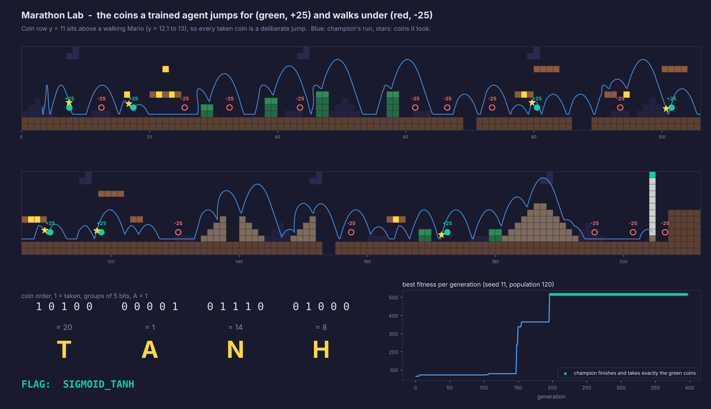

# LMML 2026 · Australia · The Drunken Mario Adventures

Oceania track (Reinforcement Learning) · Medium · 200 points

**Flag: `SIGMOID_TANH`**



## The answer in one paragraph

Marathon Lab trains a population of Marios with a genetic algorithm. Its fitness function hides a table for 20 coins that hang just above a walking Mario's head: 7 of them are worth +25, the other 13 are worth −25. So a trained Mario jumps out of his way for 7 coins and walks straight under the other 13, the same way every run. That is the habit from the story. Reading the coins left to right as bits (taken = 1) and cutting them into 5-bit letters with A = 1 gives `10100 00001 01110 01000` = **T A N H**, the activation function that goes with "sigmoid".

## What is in this folder

| Path | What it is |
|---|---|
| `solve.sh` | One command: unpack, read the coin table, train and check the behaviour, draw the figure |
| `tools/extract_onefile.py` | Unpacks the Nuitka onefile build (`KAY` + zstd payload) into a normal folder |
| `tools/inject.c` | Small `LD_PRELOAD` library that runs a Python file inside the running game |
| `probes/dump_reward_table.py` | Runs inside the game: reads the coin table, measures each coin's reward, decodes the word |
| `probes/train_and_verify.py` | Runs inside the game: trains a fresh population headless until the champion stops changing, then checks which coins it takes |
| `analysis/plot_coin_message.py` | Draws `results/coin_message.png` |
| `results/` | Everything the scripts produced (see below) |

The game itself is not included. Download `marathon-lab-linux-x86_64` from the task page (the copy used here has SHA-256 `569dd52d9a4ff551798caff32c7eb3a1f5e462e14225d93f55a42dff25f2eca4`).

## How it was solved

### 1. Unpack the build

`marathon-lab-linux-x86_64` is a 160 KB ELF bootstrap with a payload appended: the magic `KA`, a `Y` (compressed), a zstd stream, and a final little-endian u64 with the payload length. The stream is a flat list of files (`name\0`, one flag byte, u64 size, data). It holds 448 files: `marathon-lab.bin` (CPython 3.12 with the game compiled in by Nuitka), the pygame and numpy libraries, and one data file, `lab/proven.npy` (1,902 float32 weights).

### 2. Run Python inside the game

The game code (`lab.level`, `lab.fitness`, `lab.engine`, `lab.brain`, `lab.evolution`, `main.py`) is compiled to C, so there is no bytecode to decompile. But `marathon-lab.bin` exports the Python C-API (its numpy and pygame extensions need it). `tools/inject.c` is preloaded with `LD_PRELOAD`, waits for `Py_IsInitialized()`, takes the GIL and calls `PyRun_SimpleString` on a probe file. Inside that probe the real compiled modules import like any others, so their tables can be read and their functions called. Everything runs headless with `SDL_VIDEODRIVER=dummy`.

### 3. Read the hidden coin table

`lab.level` puts 20 coins on row `y = 11` at `x = 7, 12, 17, 25, 32, 43, 61, 66, 73, 80, 93, 101, 110, 118, 130, 157, 172, 195, 201, 206`. A standing Mario occupies `y = 12.1 … 13.0` (ground top 13, height 0.9), so he can walk under a coin without touching it and only collects it by jumping into it. The probe checks this by holding RIGHT from the spawn: Mario passes under the coins at x = 7 and 12 and collects nothing.

`lab.fitness` keeps a table `_SIGN[(x, 11)]` of one bit per coin. It is not stored directly: the bits are `_BASIS XOR _spread(COIN_SITES)` (`919247 XOR 262919`), so they depend on the coin positions. Calling `lab.fitness.reward` on the same step with and without each coin gives exactly +25 for a 1 and −25 for a 0. The other terms read from the module are +1 per tile of progress, −0.01 per step, +150 for reaching the flag and 0 for dying.

| Coin x | 7 | 12 | 17 | 25 | 32 | 43 | 61 | 66 | 73 | 80 | 93 | 101 | 110 | 118 | 130 | 157 | 172 | 195 | 201 | 206 |
|---|---|---|---|---|---|---|---|---|---|---|---|---|---|---|---|---|---|---|---|---|
| Reward | +25 | −25 | +25 | −25 | −25 | −25 | −25 | −25 | −25 | +25 | −25 | +25 | +25 | +25 | −25 | −25 | +25 | −25 | −25 | −25 |
| Bit | 1 | 0 | 1 | 0 | 0 | 0 | 0 | 0 | 0 | 1 | 0 | 1 | 1 | 1 | 0 | 0 | 1 | 0 | 0 | 0 |

| Bits | 10100 | 00001 | 01110 | 01000 |
|---|---|---|---|---|
| Value | 20 | 1 | 14 | 8 |
| Letter (A = 1) | T | A | N | H |

With A = 0 the same bits would read `UBOI`, so A = 1 is the intended alphabet.

### 4. Check it against behaviour

The table only says what the agents are paid for, so `probes/train_and_verify.py` checks what they actually do. It trains a fresh population of 120 with the game's own `lab.evolution.Lab`, headless and deterministic for a given seed. After every generation it replays the champion (`Lab.best_ever`) and records which coins it takes. It stops once the champion has finished the level and its coin choices have not changed for 200 generations.

| | Seed 11 | Seed 7 |
|---|---|---|
| First champion to reach the flagpole | generation 149, coins `11001 01110 11111 11100` | generation 141, coins `10100 00001 00101 01100` |
| Champion that never changes again | generation 196, fitness 514.21 | generation 182, fitness 514.21 |
| Stopped (200 generations unchanged) | generation 396 | generation 382 |
| Coins the settled champion takes | x = 7, 17, 80, 101, 110, 118, 172 | x = 7, 17, 80, 101, 110, 118, 172 |
| Bits → word | `10100 00001 01110 01000` → **TANH** | `10100 00001 01110 01000` → **TANH** |

Both settled champions finish the level in 1,197 steps, their replays are deterministic, and their coin choices are exactly the table above. Both are also bit-for-bit the bundled genome `lab/proven.npy` (see below). `results/training_log.csv` has every generation of the seed-11 run, and `results/seed7/` has the seed-7 run.

### Pitfalls worth knowing

- **Reaching the flagpole is not the end.** The first champions to finish still grab some −25 coins and miss some +25 ones (their bits spell nonsense). They need many more generations before their choices settle, which is what the task text warns about.
- **Don't replay agents from a second thread while the app trains.** `lab.brain.sense` writes features into module-level numpy buffers, so two threads stepping agents at once corrupt each other and the same champion seems to take different coins on every replay. `probes/train_and_verify.py` pauses the app's own training first.
- `lab/proven.npy` is a bundled genome that `lab.evolution` mixes into the population each time it stalls (`lab.rescues` counts these). Replayed on its own, with the app paused, it finishes the level and takes exactly the 7 coins of the table, which is why both runs end with the very same champion.

## Reproduce

Linux x86-64 (WSL works), Python 3 and gcc:

```bash
pip install -r requirements.txt
./solve.sh /path/to/marathon-lab-linux-x86_64           # table, flag, training check (10-15 min), figure
VERIFY=0 ./solve.sh /path/to/marathon-lab-linux-x86_64  # table and flag only, about 10 seconds
SEED=7 ./solve.sh /path/to/marathon-lab-linux-x86_64    # training check with another seed
```

`results/` then holds:

| File | Content |
|---|---|
| `reward_table.txt` / `.json` | The coin table, the reward of each coin, the walking check and the decoded word |
| `training_log.csv` | One line per generation: best fitness, whether the champion finishes, its coin bits and word |
| `verify_summary.txt` / `.json` | Where the champion settled and whether its coins match the table |
| `champion_path.csv` | The settled champion's run, step by step (x, y, action, coins so far) |
| `champion_genome.npy` | Its weights (72 inputs, 24 hidden, 6 actions; 1,902 values) |
| `coin_message.png` | The figure above |
| `seed7/` | The same check with seed 7 (`training_log.csv`, `verify_summary.*`) |

To see it the intended way, run the app on its own, wait until the population has finished learning and the champion stops changing, then switch to **BEST ONLY**: Mario jumps for the green coins of the figure and walks under the red ones.

## Short write-up (for the submission form)

Marathon Lab is a Nuitka-compiled pygame app, so I unpacked the onefile build and ran my own Python inside the live process through a small `LD_PRELOAD` library, which let me read the compiled `lab.fitness` and `lab.level` modules directly. The fitness function pays +25 or −25 for each of 20 coins placed one tile above a walking Mario, using a hidden bit table (`_BASIS XOR _spread(COIN_SITES)`). A trained agent therefore jumps for the 7 positive coins and walks under the 13 negative ones. I confirmed this by training fresh populations with the game's own evolution code (seeds 11 and 7): the champions stop changing at fitness 514.21 and take exactly the coins at x = 7, 17, 80, 101, 110, 118 and 172. In coin order that is `10100 00001 01110 01000`, which with A = 1 reads T-A-N-H. Flag: `SIGMOID_TANH`.
