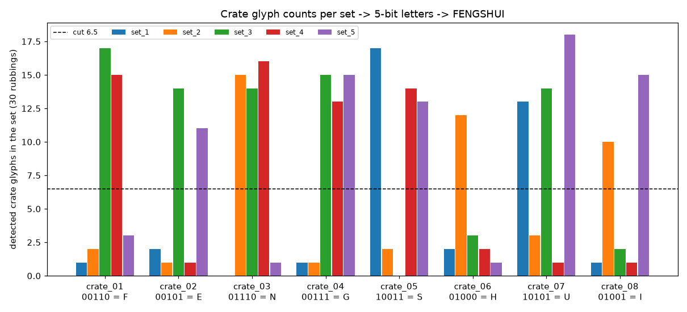

# China: Carved in bones, engraved in the heart

**Flag: `SIGMOID_FENGSHUI`**

## How

1. **Detector** (`detector.py`). CenterNet-style, trained from scratch on the 1,800 labelled rubbings (14,149 boxes).
   - It has one heatmap per glyph id (210 ids plus `rare`) and a box-size head, with a ResNet-like encoder and an upsampling decoder at stride 4.
   - Training uses random 512 px canvases, scale 0.7-1.3, contrast, brightness, noise and blur. There are no flips, since mirrored glyphs can be different characters.
   - A glyph is a local maximum of its class heatmap above a threshold.
2. **Holdout check.** On 150 rubbings left out of training, I compared counts of the 8 crate glyphs at threshold 0.3: 265 predicted against 261 true (`train_log.txt`, last lines).
3. **Counting** (`count_crates.py`). Each crate's glyph is counted in all 30 rubbings of each of its 5 sets, giving `counts.csv`. The same counts at thresholds 0.2-0.5 are in `counts_by_threshold.csv`.
4. **Decoding** (`decode.py`).
   - Every set count is either high (10-18) or near zero (0-3), with a wide gap between the two groups.
   - High = 1 and low = 0. Read with set_1 first, the five sets give a 5-bit number, and the letter is that position in the alphabet (A = 1).

| crate | glyph | counts set_1..5 | bits | letter |
|---|---|---|---|---|
| crate_01 | 賓 | 1 2 17 15 3 | 00110 | F |
| crate_02 | 今 | 2 1 14 1 11 | 00101 | E |
| crate_03 | 其 | 0 15 14 16 1 | 01110 | N |
| crate_04 | 㞢 | 1 1 15 13 15 | 00111 | G |
| crate_05 | 王 | 17 2 0 14 13 | 10011 | S |
| crate_06 | 不 | 2 12 3 2 1 | 01000 | H |
| crate_07 | 貞 | 13 3 14 1 18 | 10101 | U |
| crate_08 | 雨 | 1 10 2 1 15 | 01001 | I |

The word is the same at detector thresholds 0.25-0.4. At 0.2 one letter flips (FENGSNUI); at 0.5 high counts drop and two letters change.



## Files

- `counts.csv`: `crate,set,glyph_id,count` (deliverable, threshold 0.3)
- `counts_by_threshold.csv`, `detections.csv`: counts at all thresholds, and every detection with score and box
- `counts_bits.png`, `decode_log.txt`, `count_log.txt`, `train_log.txt`: outputs
- `detector.py`, `count_crates.py`, `decode.py`: code
- `detector.pt`: trained weights

Run:

```
python detector.py train --data ../task_china --val 150 --epochs 40
python count_crates.py --data ../task_china --model detector.pt --thr 0.3
python decode.py
```

`train_log.txt` also holds the lines of an earlier run that was cut off by a restart; the final run resumes from step 500 ("resumed at step 500"). Needs torch, numpy, pandas, pillow, matplotlib. No pretrained weights are used.
