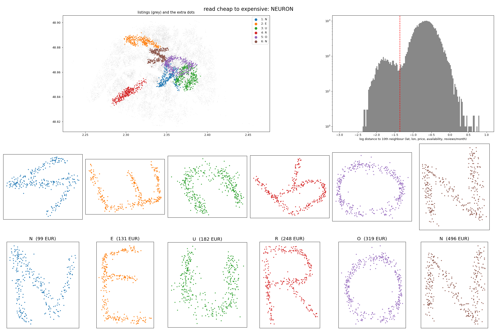

# Point par point

**SIGMOID_NEURON**

`python point_par_point.py` (about 1.5 min) prints the letters and the flag, writes `labels.csv` and `letters.png`.

- The extra dots look like real listings: no single column and not the plain map shows them.
- In (lat, lon, log price, availability/365, log reviews/month), z-scored, each letter is a thin 2-d sheet; real listings are spread out. Distance to the 10th neighbour has two modes (-1.81 and -0.64), valley at -1.36: 1,862 candidates.
- DBSCAN (eps 0.25, min 6): 6 big clusters and two small ones (25 and 13 rows, dense real spots, left as background). Points just above the cut that sit on a letter's sheet are added back: 2,025 dots, 291-380 per letter.
- PCA of each cluster shows the letter. Affine fit against A-Z skeletons (DejaVu Sans): N/Z, E, U, R, O, Z/N. N and Z are the same shape turned 90 degrees.
- Order: the "colour" a traveller weighs is the nightly price. By median price (99, 131, 182, 248, 319, 496 EUR) the letters read N E U R O N; of the N/Z options only NEURON is a word. Ordering by availability, reviews or west-east gives nothing.

`labels.csv`: listing_id, cluster (-1 background), letter, label (N1 ... N6).
