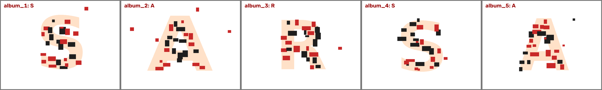
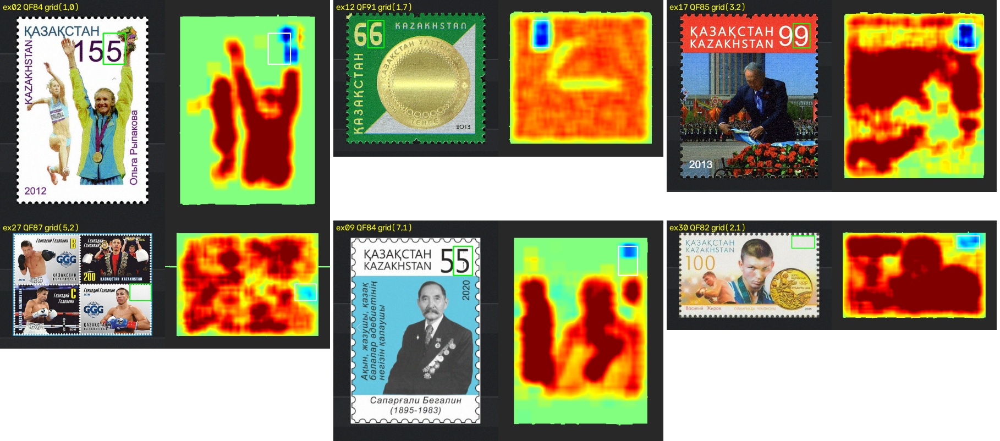
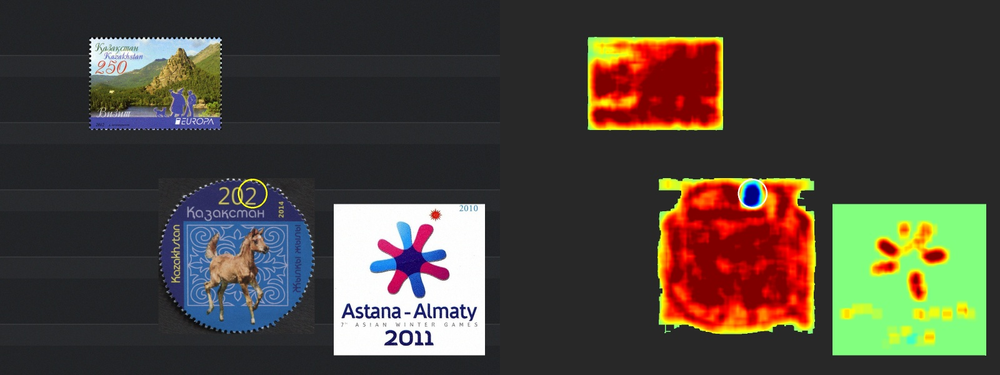

# Stamp of Disapproval — write-up

**Flag: `SIGMOID_SARSA`**

The altered regions of the 26 pages of each album, drawn on one sheet, spell **S · A · R · S · A**
(SARSA, the State–Action–Reward–State–Action reinforcement-learning algorithm).

*Detected region of every page, per album (black: decided by strong double-quantisation evidence,
red: decided by the classifier), over a bold glyph of the letter read from them.*

## 1. What the forger left behind

Profiling the exhibits (30 altered stamps with masks) gave two independent traces.

**Double quantisation (the main one).** Every stamp on a page carries an earlier JPEG compression of
its own: a standard libjpeg luminance table at quality 82–92 (fitted by maximum likelihood on all 387
stamps: QF 82…92 almost uniformly), on its own 8×8 grid offset. The page was then saved again at q97.
Pixels that were *not* touched still have DCT coefficients (computed on the stamp's grid) sitting on the
lattice of the first quantisation table; pasted digits, cloned elements, filled inscriptions and the
synthetic noise added over them do not. This works for all three edit types at once and needs no
reference copy of the stamp.

*Exhibits with ground truth (green / white outline) and the per-block log-likelihood ratio map
(red = consistent with the stamp's first compression, blue = contradicts it, green = no information).*

On album page `album_1/page_1759` the only contradiction on the whole page is the last "2" of the
non-existent denomination **202**:

**Noise statistics.** Filled areas are either too smooth (inpainting / flat fill, e.g. a constant 254 in
white paper) or carry synthetic noise that is white and *independent per colour channel* (cross-channel
correlation ≈ 0.1 against ≈ 0.9 for the stamp's own noise); fills in white paper also lack the clipped
255 highlights of real paper. These cues matter where DQ has nothing to say (clipped white paper).

## 2. Pipeline (`code/`)

| step | file | what it does |
|---|---|---|
| segmentation | `segment.py` | per-row background model of the stock-book page → stamp masks (handles dark stamps and small strips) |
| DQ forensics | `dq.py` | per stamp: grid offset search (64 offsets), ML fit of first-compression QF + noise σ, per-block LLR over DC + 27 AC frequencies; two clipping variants; a second grid is fitted when two touching stamps form one component; 12 px perforation band ignored |
| noise features | `noise_features.py`, `nlf.py` | local residual covariance eigen-features, channel correlation, chroma HF energy, autocorrelation, flatness, white-paper 255-fraction; per-stamp noise-level-function residuals (what the local content does **not** explain) with centre–surround and stamp-normalised context |
| features | `allfeatures.py`, `build_cache.py` | 132 features per pixel; exhibits as full maps, pages at stride 2 inside stamps |
| detector | `train_detect.py` | gradient boosting on exhibit pixels (mask = positive), then 3 rounds of self-training on the pages using the only page-level fact given: **exactly one altered region per page** (pseudo-negatives far from the current best candidates, pseudo-positives at the best candidate of the most confident half) |
| decision | `train_detect.py` / `finalize.py` | per page: if the strongest DQ contradiction (33×33 window, summed LLR) is below −50 it is taken as is; otherwise the classifier's best region. Box = the probability blob around it |
| sheets | `draw_sheets.py`, `overlay_glyphs.py` | regions of each album on one sheet (+ a "lamp" view: all pages of the album averaged with the boxes) |
| checks | `loo_eval.py`, `dq_rule_check.py`, `letter_check.py` | validation (below) |

Run everything: `python code/run_all.py --data <task_kazakhstan> --work ./work --loo`
(~30 min of features + ~10 min training on 2 CPU cores; `pip install -r code/requirements.txt`).

## 3. Validation

* **Strong-DQ rule on exhibits** (`outputs/validation/dq_rule_exhibits.txt`): it fires on 13 of 30
  exhibits and is right 13/13. On the pages it decides 58 of 130 pages (11/11/13/13/10 per album).
* **Leave-one-exhibit-out** for the classifier (train on 29 exhibits, localise the held-out one):
  **25 / 30** hits (`outputs/validation/loo.txt`; the region is "hit" when the probability peak falls
  inside the true mask). The misses are edits inside clipped white paper with almost no
  signal, and edits that were made *before* the stamp's first compression (no DQ trace).
* **Letter check** (`outputs/validation/letter_check.txt`): every capital A–Z rendered in three bold
  sans fonts is fitted to each album's region centres; best letters: album 1 **S** (F-score), album 2
  **A**, album 3 **R**, album 4 **S** (excess-over-chance; B is a close second on F), album 5 **A**.
  Visual reading of the sheets agrees: **SARSA**.

## 4. Outputs

* `outputs/boxes.csv` — one box per page: `album,page,x,y,w,h,source,score,classifier_top,dq_min`
* `outputs/sheets/` — `sheet_album_N.png` (tracing paper), `lamp_album_N.jpg`, `all_albums.png`, `letters_check.png`
* `outputs/run/` — candidate peaks per self-training round, training log
* `outputs/validation/` — LOO, DQ rule check, letter check
* `outputs/figures/` — DQ evidence figures

No catalogue or internet copy of any stamp was used; every box comes from the code above.
