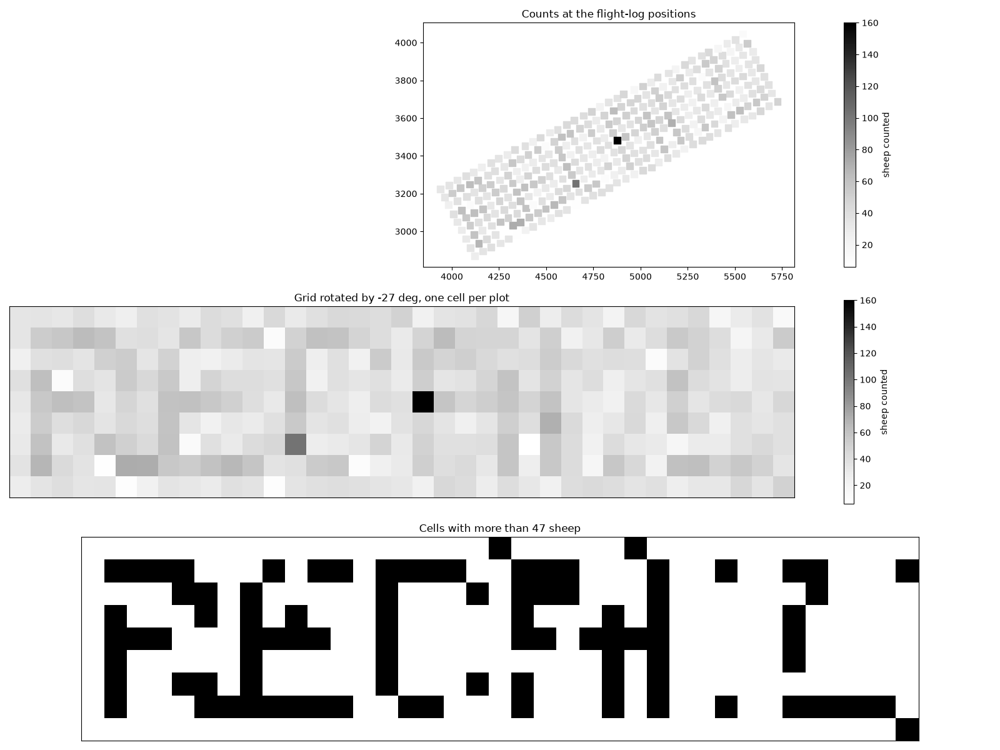

# Mongolia: The Baa-rilliant task

**Flag: `SIGMOID_RECALL`**

## How

1. **Counting** (`count_sheep.py`). Small U-Net trained from scratch for density maps. Each training dot becomes a Gaussian (sigma 3 px); the count is the sum of the predicted map. Training uses random 320 px crops, rotations, flips and colour jitter, and test time averages 8 rotations/flips.
   - On 40 held-out training photos: MAE 6.9 for a mean of 37 sheep (`val_predictions.csv`). The worst miss is `train_107.jpg`, which shows about 75 sheep but is labelled 0 with no points. That photo is left out of the final training.
   - Final counts are the mean of two models trained on all photos with different seeds (`ensemble_counts.py`). The two models differ by 2.3 sheep per photo on average.
2. **Census map** (`plot_census.py`).
   - The 333 plots sit on a regular 50 m grid of 37 x 9 cells, tilted by 27 degrees. I rotated it back with a proper rotation (no mirroring) and snapped each plot to its cell.
   - Background cells have about 35 sheep; letter cells have about 55-60.
   - The grid splits into six 5x7 letters with one-cell gaps: **R E C A L L**.
   - The fifth letter is the weakest (its bottom bar is faint), but the left bar is clear, and the word only fits as RECALL.



## Files

- `counts.csv`: `image,count` for the 333 survey photos (the deliverable)
- `counts_raw_s0.csv`, `counts_raw_s1.csv`: unrounded counts from each model
- `census_map.png`, `census_map.grid.csv`: the map and the 9x37 grid of counts
- `count_sheep.py`, `ensemble_counts.py`, `plot_census.py`: code
- `train_log*.txt`, `val_predictions.csv`: run outputs

Run:

```
python count_sheep.py --data ../task_mongolia --val 40                    # holdout check
python count_sheep.py --data ../task_mongolia --val 0 --seed 0 --out counts_s0.csv && copy counts_raw.csv counts_raw_s0.csv
python count_sheep.py --data ../task_mongolia --val 0 --seed 1 --out counts_s1.csv && copy counts_raw.csv counts_raw_s1.csv
python ensemble_counts.py
python plot_census.py --data ../task_mongolia --counts counts.csv
```

Needs torch, numpy, pandas, pillow, matplotlib. No pretrained weights are used.
